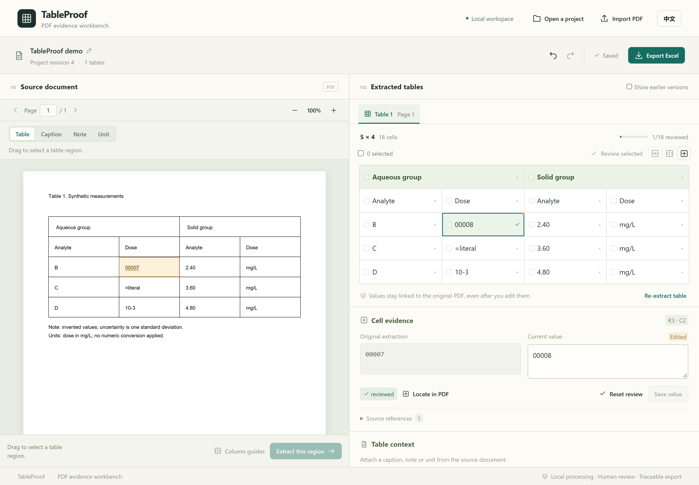

# TableProof Research

**把论文 PDF 表格整理成可核对、可追溯来源的 Excel。**

[English](README.md) · [验证记录](docs/verification.md) · [贡献指南](CONTRIBUTING.md)

TableProof 是面向研究人员的本地表格核验工作台。框选论文表格后，点击单元格即可回看原文，纠正文字和结构，再导出带来源引用与修订记录的 Excel。

**打开论文 → 框选表格 → 回看原文 → 纠错与复核 → 导出 Excel。**



**当前状态：v0.1 本地预览版。** 核对与纠错流程已实现并通过测试，自动网格仍需要人工检查，详见[当前限制](#当前限制)。研究人员试用及对外发布尚未进行。

## 能做什么

| 任务 | 已实现能力 |
| --- | --- |
| 提取表格 | 框选文本型 PDF 的单页区域，必要时添加手动列分隔线 |
| 核对数据 | 点击单元格高亮原文，并排比较原始提取文字与当前值 |
| 整理结构 | 合并完整矩形区域，沿已有网格边界拆分跨格单元格 |
| 记录复核 | 标记已复核；文字或结构修改后，相关单元格重新进入待复核状态 |
| 补充上下文 | 从原 PDF 选取表题、表注和单位 |
| 继续工作 | 本地保存、重新打开、撤销重做，以及查看旧提取版本 |
| 带来源导出 | XLSX 包含表格、来源索引、修订记录及文档与上下文信息 |

界面支持中英文。后端仅监听 `127.0.0.1`，同源提供前端；PDF.js worker、字体和字符映射资源随程序打包。日常使用无需联网或模型密钥，文档保存在本地项目目录。

## 快速开始

### Windows 便携包

如果已有本地预览包 `TableProof-0.1.0-windows-x64.zip`，无需安装 Python 或 Node.js。

1. **完整解压 ZIP**，保留 `TableProof` 文件夹及其中的 `_internal` 目录。
2. 双击 `TableProof/Start.cmd`。
3. 浏览器会打开 [http://127.0.0.1:8765](http://127.0.0.1:8765)；若未自动打开，手动访问该地址。
4. 打开内置示例体验流程，或导入自己的文本型 PDF。

使用期间保留控制台窗口，关闭窗口即可停止服务。如果 8765 端口被占用，在解压后的 `TableProof` 目录运行：

```powershell
.\TableProof.exe --port 8766
```

便携包只内置演示 PDF，完整几何样例和论文语料在源码目录中。ZIP 是 `dist/` 下的构建产物，不随 Git 跟踪；只有源码时，请使用下面的启动方法。

### 从源码运行

需要 **Python 3.13**、**Node.js 24** 和 [uv](https://docs.astral.sh/uv/)。首次安装依赖需要联网，构建完成后可以本地运行。依赖版本由 `uv.lock` 与 `frontend/package-lock.json` 锁定。

在 **仓库根目录**打开 Windows PowerShell，依次执行：

```powershell
uv sync --frozen --cache-dir .tools/uv-cache
npm.cmd --prefix frontend ci
npm.cmd --prefix frontend run build
uv run --frozen --cache-dir .tools/uv-cache tableproof
```

Linux/macOS 的 Bash 命令使用 `npm`：

```bash
uv sync --frozen --cache-dir .tools/uv-cache
npm --prefix frontend ci
npm --prefix frontend run build
uv run --frozen --cache-dir .tools/uv-cache tableproof
```

本地验证在 Windows 上完成；仓库提供 Windows 与 Ubuntu CI 配置，尚未在远端执行。

可选启动参数：

```powershell
uv run --frozen --cache-dir .tools/uv-cache tableproof --port 8766 --data-dir ./local-projects --no-browser
```

`--port` 指定本地端口，`--data-dir` 指定项目目录，`--no-browser` 关闭自动打开浏览器。

## 核验第一张表格

1. **导入并框选。** 打开内置示例，或导入可以选中文字的 PDF。切换到目标页，在“表格”模式下框住完整表格，点击“提取选中区域”。上传完成后可以查看解析进度或取消解析。
2. **回看来源。** 点击单元格，左侧 PDF 高亮来源，右侧“单元格证据”显示原始提取文字与当前值。空单元格使用区域来源引用。
3. **保存纠错。** 修改当前值后点击“保存修改”。仅输入文字会形成未保存草稿；切换单元格、项目或导出时，会提示保存、放弃或继续编辑。保存失败会保留草稿。
4. **整理结构。** 勾选单元格复选框，选择完整且相邻的矩形区域后合并。拆分时选择一个跨格单元格和已有行／列边界；如果文字已修改，需要明确填写拆分后的两个值。
5. **附加上下文并复核。** 切换到“表题”“表注”或“单位”模式，框选对应原文并附加。确认内容后标为已复核；再次编辑会重置复核状态。
6. **导出并继续。** 点击“导出 Excel”。待复核单元格也可以导出，核对状态会保留。下次通过“打开项目”继续工作。

列边界错误时，点击“重新提取表格”，启用“列分隔线”，在选区内单击添加边界，再次点击分隔线可以移除，最后执行提取。新表从 PDF 重新生成；旧改值和复核状态保留在旧版本中，不迁移到新表。启用“显示旧版本”即可回看。

选区内未进入检测网格的文字会单独显示，并保留来源引用。请检查选区或补充列线，确认表格完整后再使用结果。

## Excel 包含什么

| 工作表 | 内容 |
| --- | --- |
| `Table 1`、`Table 2` 等 | 每个表格版本的当前值、合并结构与上下文；旧版本会注明已被替代 |
| `Sources` | 文件哈希、页码、PDF 坐标、字符 ID 和核对状态；单元格链接指向此索引 |
| `Changes` | 修改历史，包括纠错及撤销重做操作 |
| `Metadata` | 文档信息、表格上下文、提取策略与警告 |

所有值默认按**字面字符串**写入，保留 `00007`、科学符号及 `=` 开头的文字。需要计算时，请在复核之后自行转换数值列。超出 Excel 单元格限制或包含不支持的控制字符时，会明确提示导出错误。

XLSX 保存来源引用，**不嵌入原 PDF**。需要完整回看证据时，请保留或分享整个项目目录。

## 数据保存与隐私

默认项目目录：

| 系统 | 目录 |
| --- | --- |
| Windows | `%LOCALAPPDATA%/TableProofResearch` |
| Linux/macOS | `~/.local/share/TableProofResearch` |

每个项目包含不被编辑覆盖的 `source.pdf`，以及保存文件哈希、字符位置、表格、上下文与编辑历史的 `project.json`。JSON 使用原子替换保存，成功写盘后才确认操作完成；保存失败时原项目文件仍保留。

可以使用 `--data-dir PATH` 或 `TABLEPROOF_DATA_DIR` 修改位置。建议停止服务后备份**整个项目目录**。同一数据目录只供一个服务使用，运行时不要手动修改项目 JSON。多个浏览器标签提交修改时会检查项目版本，防止旧内容覆盖较新的修改。

## 当前限制

- 支持文本型 PDF 与**单页表格**。OCR、自动跨页拼接、统计结论审查、云服务及多人协作不在当前预览范围内。
- 自动网格需要人工复核。当前真实论文语料的 **12 项完整结构检查均未通过**：10 项需要网格纠正，2 项因未映射字符被阻断。测试将它们记录为已知预期失败，不计作准确率通过。
- 演示中的 Giofrè 论文表格经手动列线与两次表头合并后，**80/80 个单元格**和合并结构与独立官方 XML 参考一致，文字比较仅归一化空白。这一结果仅适用于该示例。
- 无法可靠映射来源时，抽取会被阻断。“已复核”表示使用者确认。
- PDF 上限为 **100 MB**。按页检查取消，复杂单页可能延迟响应；上传阶段暂不支持取消。
- 已检查 Windows 便携启动与 Microsoft Excel 打开结果；验证机器未安装 LibreOffice，其兼容性仍待验证。

详细证据与未完成事项见[验证记录](docs/verification.md)。[5 人试用方案](docs/research-trial.md)已准备，尚未开展。中位耗时降低 30% 是待验证目标，不是已证实收益。

## 技术栈

| 层次 | 技术 |
| --- | --- |
| 前端 | React、TypeScript、Vite |
| PDF 显示 | PDF.js，本地 worker、CMaps、标准字体及 WASM |
| 本地 API | Python 3.13、FastAPI、Uvicorn |
| PDF 解析 | pdfplumber |
| Excel 导出 | openpyxl |
| 持久化 | 本地 PDF 与原子保存的 JSON |
| 打包与验证 | PyInstaller、pytest、Playwright；uv 与 npm 锁定依赖 |

来源引用使用原始、未旋转的 PDF 坐标，显示时由 PDF.js 转换。数据约定与 API 见[架构说明](docs/architecture.md)。

## 开发与验证

安装依赖后，在仓库根目录的 Windows PowerShell 中执行：

```powershell
uv run --frozen --cache-dir .tools/uv-cache pytest -q
npm.cmd --prefix frontend run build
npm.cmd --prefix frontend exec -- playwright install chromium
npm.cmd --prefix frontend run test:e2e
```

Bash 中将 `npm.cmd` 替换为 `npm`。浏览器测试使用独立数据目录。已记录的 Windows 验证结果为 **80 项 Python 测试、9 项浏览器测试通过**，另有 **12 项自动抽取已知预期失败**。主要浏览器流程会阻断外网请求。

在仓库根目录构建 Windows 便携包：

```powershell
powershell.exe -NoProfile -ExecutionPolicy Bypass -File scripts/build-portable.ps1
```

脚本构建前端和可执行程序，并将示例、文档与依赖许可打包至 `dist/TableProof-0.1.0-windows-x64.zip`。

## 参与贡献与样例

欢迎反馈错误或提交改进。报告问题时请提供页码、选区、预期结果和实际结果；使用自制或允许再分发的 PDF，避免将保密论文发到公开问题区。来源保留及测试要求见[贡献指南](CONTRIBUTING.md)。

源码包含 8 个自制几何样例，以及两篇 CC BY 4.0 PLOS 论文中的 12 个表格选区。作者、DOI、许可、哈希与选区修改说明见[语料清单](samples/papers/manifest.json)。[独立参考](samples/papers/reference.json)来自出版社 XML，与解析器输出分开保存。

## 许可证

代码与自制样例内容采用 [MIT 许可证](LICENSE)。论文样例保留 CC BY 署名，嵌入字体与依赖分别保留各自许可，详见[第三方说明](THIRD_PARTY_NOTICES.md)。
